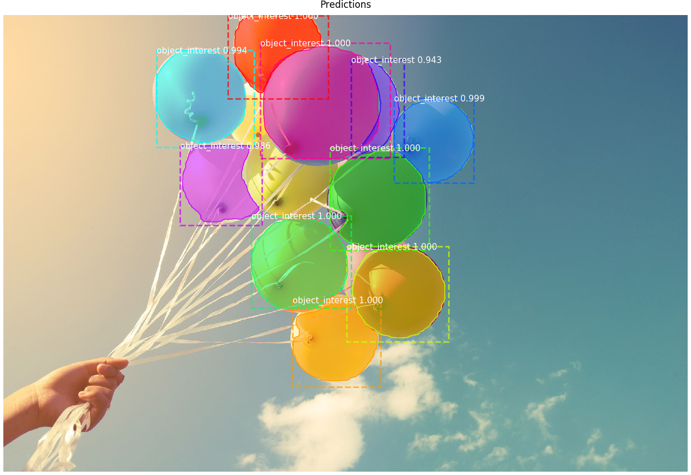
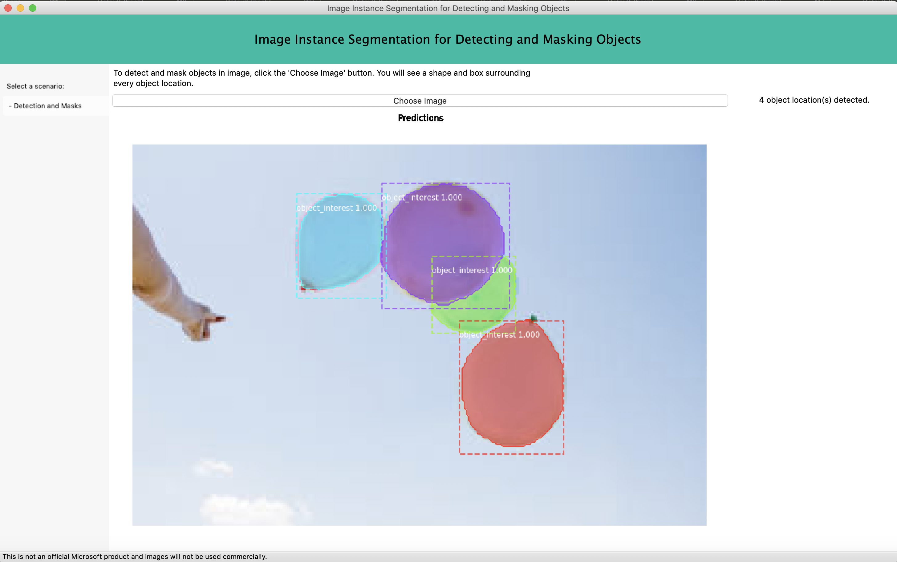

# A Python Desktop App for Instance Segmentation with Mask R-CNN


<div align="right"><a href="https://nypost.com/2019/01/20/releasing-balloons-in-east-hampton-could-cost-you-jail-time/" target="_blank">Source</a></div>

Above, a Mask R-CNN model is used to detect balloons (output of the model is the class, bounding box and mask). Mask R-CNN is an instance segmentation computer vision model based on the Faster R-CNN object detection model, with the addition of segmentation capabilities.  The original paper from 2018 can be found [here](https://arxiv.org/abs/1703.06870).

Much of the `maskrcnn_detect` package code comes from Waleed Abdulla's awesome work for Matterport, Inc. at https://github.com/matterport/Mask_RCNN.

## Running the sample

Currently, this sample desktop application supports the following combination: [Python 3](https://www.python.org/downloads/) + [wxPython 4+](https://pypi.python.org/pypi/wxPython).  This sample only supports one class at this time.

1. Train a Mask R-CNN Keras model according to https://github.com/matterport/Mask_RCNN (take a look at `maskrcnn_detect/custom.py` in this repo as well) or use a prebuilt model from the releases page of the Matterport repo: https://github.com/matterport/Mask_RCNN/releases (try with the balloon model as it is simpler than the COCO-based model at only 1 class).

2. Update the `sample/view/base.py` file if using a single-class model different from Matterport's `` model. Take a look at and update as needed the following lines of the `base.py` file (lines 18 and 19):

```
CLASS_NAME = "balloon"
WEIGHTS_PATH = "mask_rcnn_balloon.h5"
```

2. To run the app do the following, using a virtual enviroment to avoid environment errors and keep the setup contained.

```bash
git clone https://github.com/michhar/maskrcnn-python-app.git
cd maskrcnn-python-app
python3 -m venv venv
```

If using Windows, activate the virtual environment with:
```
venv\Scripts\activate
```

If using Unix based systems, activate the virtual environment with:
```
source venv/bin/activate
```

Install the required Python packages as follows (if on Windows, you may need to install some of the packages individually from a build such as can be found at [https://www.lfd.uci.edu/~gohlke/pythonlibs/](https://www.lfd.uci.edu/~gohlke/pythonlibs/)). The packages and versions are defined in the project's `pyproject.toml` file.
```
pip install --upgrade pip
pip install -e .
```

Run the sample:
```
python sample
```

If the `maskrcnn-detect` package is already installed, make sure to uninstall first, then reinstall.

`pip uninstall maskrcnn-detect -y`



## Troubleshooting

1. __This program needs access to the screen. Please run with a Framework build of python, and only when you are logged in on the main display of your Mac.__.  See:  https://stackoverflow.com/questions/48531006/wxpython-this-program-needs-access-to-the-screen

For other errors:

1.  Try `pythonw` instead of `python` or `python3`.
2.  Try using the system Python 3.
3.  Upgrade pip (`pip install --upgrade pip`).

## Contributing

Contributions are welcome. Feel free to file issues and pull requests on the repo and I'll address them as I can. Learn more about how you can help on our [Contribution Rules & Guidelines](/CONTRIBUTING.md).


## Credits

* Much of the code and idea came from https://github.com/microsoft/Cognitive-Face-Python
* The MaskRCNN code to create the package here, came from https://github.com/matterport/Mask_RCNN as well as the demo ML model.


